<div align="center">

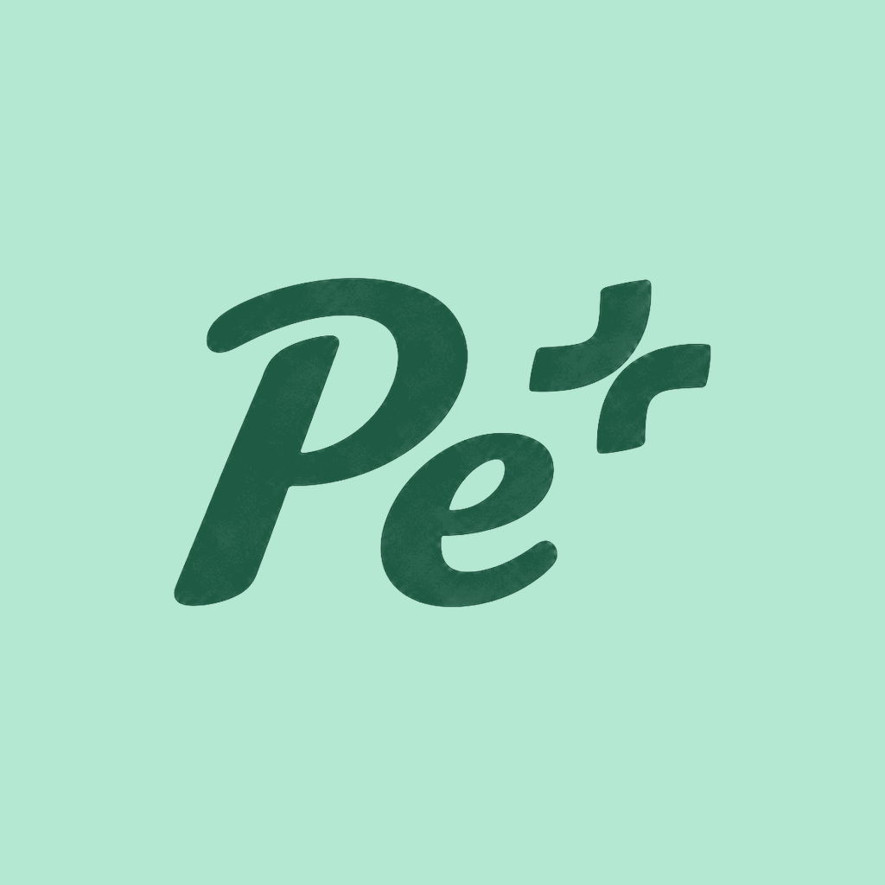

# PePlus

**All your debts. One plan.**

For people in Romania juggling several loans: what each debt really costs, what to pay first, and when refinancing actually saves money.


*Built for **Stripe VibeHack Constanța 2026**, challenge: "Rethinking Financial Futures".*

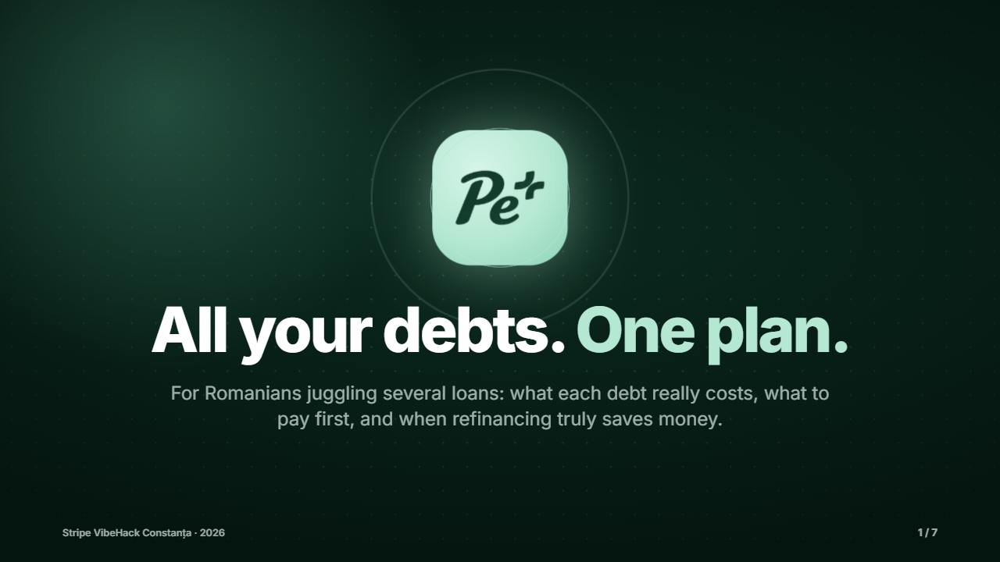

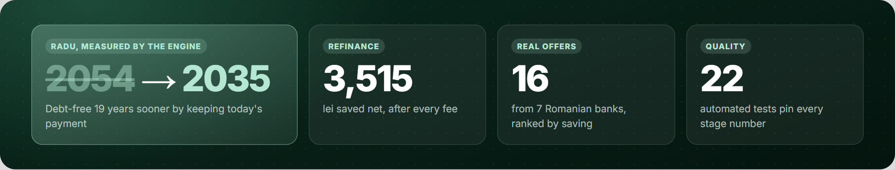

</div>

---

## Contents

1. [The 30-second version](#the-30-second-version)
2. [See it](#see-it)
3. [The problem](#the-problem)
4. [Why Romania](#why-romania)
5. [The user journey](#the-user-journey)
6. [How it works: the engine](#how-it-works-the-engine)
7. [Architecture](#architecture)
8. [Business approach](#business-approach)
9. [How we built it: the tasks](#how-we-built-it-the-tasks)
10. [Key product decisions](#key-product-decisions)
11. [Real vs. mocked](#real-vs-mocked)
12. [Run it](#run-it)
13. [Repository map & file guide](#repository-map)
14. [Pitch kit](#pitch-kit)
15. [Team](#team)

---

## The 30-second version

| | |
|---|---|
| **Who** | Romanians aged 25-40 with several debts at once: typically a mortgage, a personal loan and a credit card, often with an overdraft, BNPL or a non-bank (IFN) loan on top. |
| **Problem** | Their debts sit in different banks and apps. They don't know which one is the most expensive, whether to pay extra or refinance, or whether a bank would even accept them. |
| **What PePlus does** | Connects every bank (open banking), shows the **real yearly cost** of each debt in lei, tells you **exactly what to pay this month**, and shows refinancing **only when it saves money after every fee**, with an honest eligibility check against the BNR 40% limit. |
| **Result for our demo user Radu** | Debt-free in **Feb 2035 instead of Jun 2054** (19 years sooner) by keeping today's payment, plus **3,515 lei** saved by refinancing one loan. |
| **How we earn** | Free for the user. A partner bank pays a referral fee **only when a refinancing closes**, and the fee never changes the ranking. |

---

## See it

<table>
<tr>
<td align="center" width="30%">
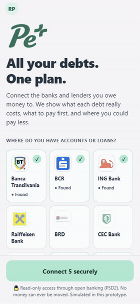<br/>
<sub><b>The full demo journey</b> (recorded, 4× speed)</sub>
</td>
<td>

| Home | This month | Pay less | Goal |
|:---:|:---:|:---:|:---:|
| 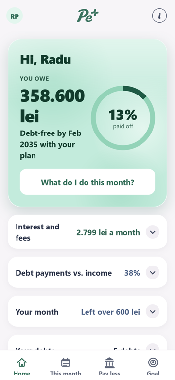 | 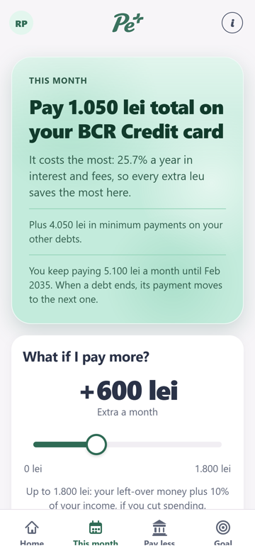 | 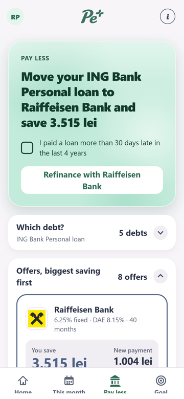 | 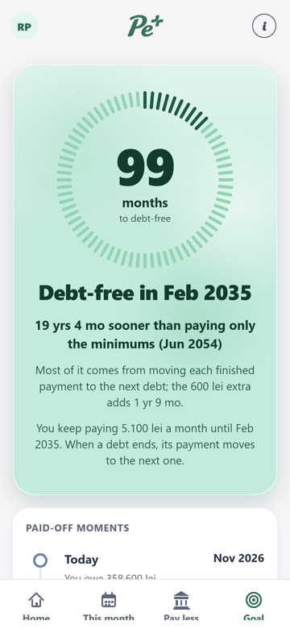 |
| Everything you owe and what it costs you | The exact move for this month | Refinancing that pays for itself | Your debt-free date |

</td>
</tr>
</table>

Full videos: [21 s ad (16:9)](english%20presentations/videos/ad-16x9.mp4) · [ad (9:16)](english%20presentations/videos/ad-9x16.mp4) · [recorded demo with captions](english%20presentations/videos/demo-backup.mp4)

---

## The problem

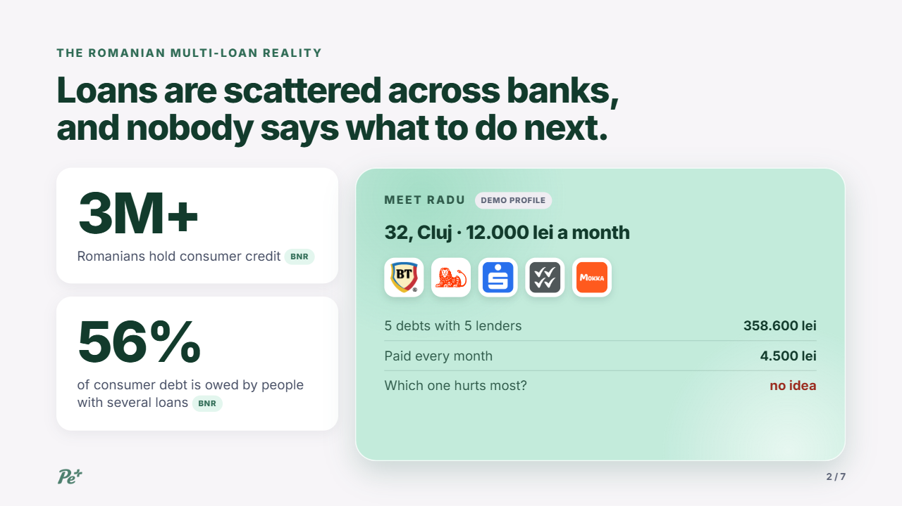

People with several loans face three blind spots:

1. **The real cost is hidden.** RON loans float on the IRCC index (older ones on ROBOR), so payments change, and monthly admin fees hide the true yearly cost (DAE).
2. **The order is a guess.** Is it better to put extra money on the mortgage, the personal loan or the card? Most people don't know.
3. **Refinancing is a gamble.** Does it really save money after exit fees and new-loan fees? And will a bank even say yes?

Bank apps only see their own loans and will never tell you to pay off a rival first. Comparison sites list rates but don't know your budget or whether you'd qualify. **Nobody tells you what to do next.**

---

## Why Romania

PePlus is built on Romanian rules, not a generic finance template:

| Rule | What it means | How PePlus uses it |
|---|---|---|
| **BNR 40% debt-to-income limit** | Total loan payments can't exceed 40% of net income for RON loans. This decides who can refinance. | Checked up front on every offer; people over the limit get a path back under it. |
| **OUG 52/2016** | Early repayment of a mortgage is free. | Paying extra or moving the mortgage costs 0 lei in exit fees. |
| **OUG 50/2010** | Consumer loans: free early repayment on variable rates, at most 0.5-1% on fixed rates. | Exit fees are applied exactly when computing net savings. |
| **IRCC / ROBOR** | Floating reference indices for RON loans. | The real cost is recomputed from current rates and fees. |
| **PSD2 (Law 209/2019)** | Licensed aggregators can read accounts across banks, read-only. | The connection flow mirrors a real PSD2 consent (simulated in the prototype). |
| **Biroul de Credit, 4-year retention** | Late payments stay on file for 4 years; there is no public API. | One honest question: *"Any payment more than 30 days late in the last 4 years?"* |

**Market:** 3M+ Romanians hold consumer credit, and 56% of consumer debt is owed by people with several loans (BNR).

---

## The user journey

<p align="center">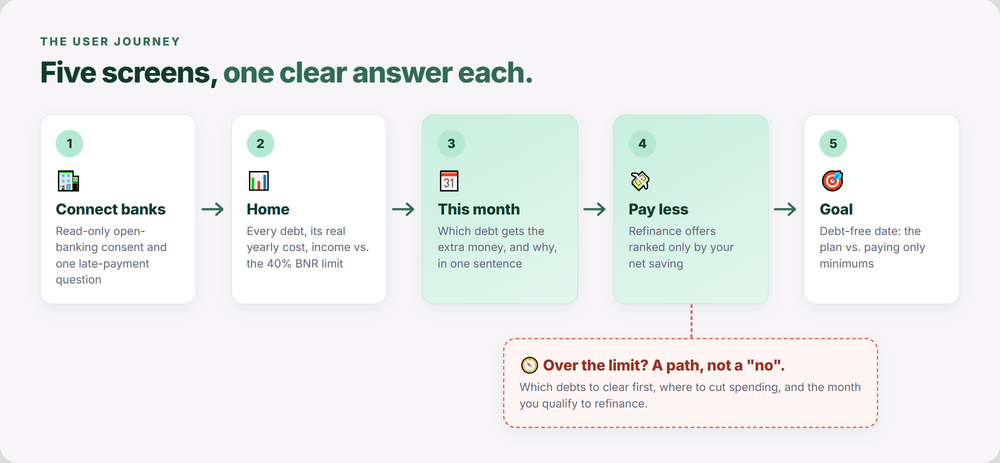</p>

| Step | What the user sees |
|---|---|
| **1. Connect banks** | Picks their Romanian banks (BT, BCR, ING, Raiffeisen, BRD, CEC, UniCredit, plus Credius and Mokka), reviews a read-only 90-day consent screen, watches the sync, answers one late-payment question. |
| **2. Home** | Total owed, monthly payments, **interest and fees paid every month**, the debt-to-income ratio against the BNR 40% limit, and a card per debt with lender, rate, DAE and real yearly cost in lei. Details are folded away until you ask for them. |
| **3. This month** | The plan: keep every minimum, put the whole surplus on the most expensive debt, roll each finished payment into the next. A **"What if I pay more?"** slider shows the new debt-free date live, and a payment calendar shows what is due when. |
| **4. Pay less** | Real offers from 7 banks, ranked **only** by what the user saves after exit and new-loan fees. "Refinance with &lt;bank&gt;" sends a (simulated) application with a reference number, saved to the backend. |
| **5. Goal** | Debt-free date with the plan vs. paying only minimums, a chart of total debt over time, and the milestones where each debt is paid off. |
| **About ⓘ** | Data sources, Romanian rules, how PePlus makes money, and what is simulated. |

Everything is available in **English and Romanian**, switchable from the profile sheet.

### Not eligible? We don't just say no.

<table>
<tr>
<td width="62%">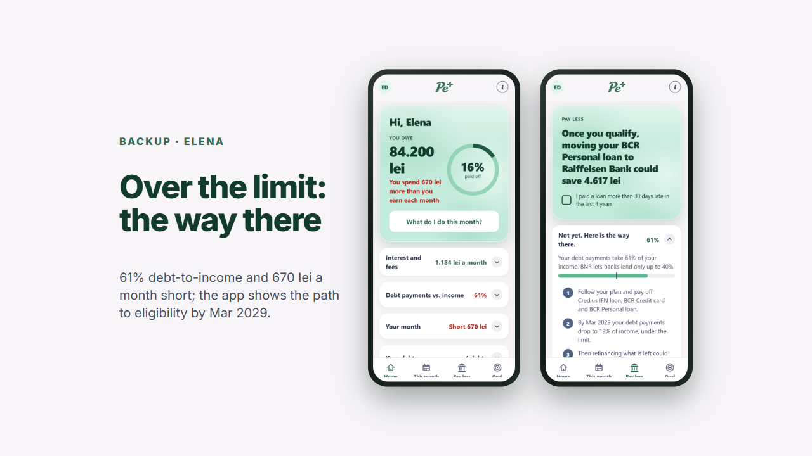</td>
<td align="center">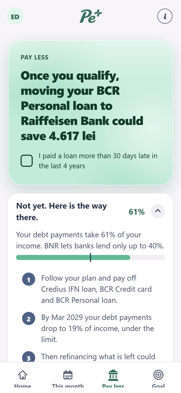</td>
</tr>
</table>

Elena pays **61.3%** of her income to debt and spends **670 lei a month** more than she earns. Instead of a dead end, PePlus shows her three biggest spending categories (a 20% cut frees ~444 lei a month), the payoff order (Credius → BCR card → BCR personal loan), and the month she gets back under the limit: **March 2029, at 19%**, when refinancing the rest saves her **3,473 lei**.

### Demo profiles

| | Radu | Elena | Andrei |
|---|---|---|---|
| **Profile** | 32, Cluj · 12,000 lei/month | 29, Bucharest · 5,500 lei/month | 26, Iași · 6,200 lei/month |
| **Debts** | 5: mortgage (BT), personal loan (ING), card (BCR), IFN (Credius), BNPL (Mokka) · 358,600 lei | 4, with past late payments | Card, overdraft, leasing, BNPL |
| **Debt-to-income** | 37.5% (under the limit) | 61.3% (over the limit) | |
| **Story** | Happy path: +600 lei on the BCR card, refinance ING with Raiffeisen | Struggling: the path to eligibility | Together the three cover all 7 debt types |

---

## How it works: the engine

All the money maths lives in [`src/engine/`](src/engine/): plain, deterministic TypeScript that runs on the phone, with no external maths libraries. Same input, same answer, every time, and every number can be checked by hand. We deliberately kept generative models out of the money logic: interest, legal fee caps and the BNR limit are exact formulas, and a wrong guess could cost a borrower thousands of lei.

<p align="center">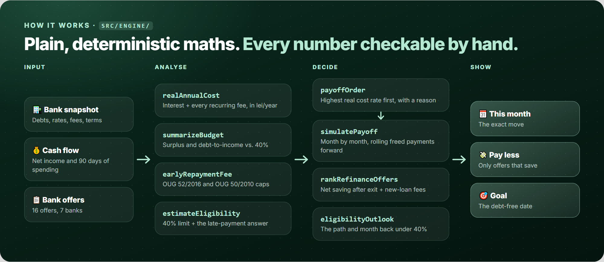</p>

| Function | Job |
|---|---|
| `realAnnualCost` | What a debt really costs per year: interest plus every recurring fee, in lei. |
| `summarizeBudget`, `monthlySurplus`, `debtToIncomeRatio` | Income vs. expenses vs. minimum payments; debt-to-income against the BNR 40% limit. |
| `payoffOrder` | The avalanche order by real cost rate, each with a one-sentence reason. |
| `simulatePayoff` | Month-by-month simulation with rollover; term loans settle at maturity in the minimums baseline so the comparison is fair. |
| `earlyRepaymentFee` | Exit fees by Romanian law: 0% on mortgages and variable consumer loans, capped on fixed ones. |
| `rankRefinanceOffers` | Ranks offers by the user's net saving after all fees. If nothing saves money, it says so. |
| `estimateEligibility`, `eligibilityOutlook` | Can they refinance today? If not, the exact path and the month they qualify. |
| `spendingBreakdown` | The top spending categories for people who spend more than they earn. |

**22 automated tests** ([`src/engine/engine.test.mjs`](src/engine/engine.test.mjs), [`src/backend/backend.test.mjs`](src/backend/backend.test.mjs)) cover real cost, budget, avalanche rollover, legal fee caps, offer ranking, eligibility outlook, spending breakdown, the backend fallback, and regression checks that pin every number used on stage. `npm run demo-numbers` prints those numbers straight from the engine, so the pitch and the app can never disagree.

---

## Architecture

<p align="center">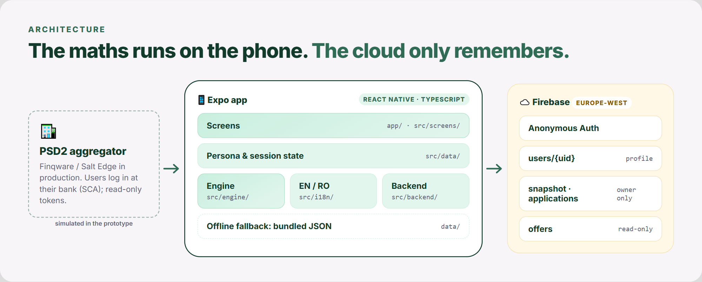</p>

- **App:** Expo SDK 57, React Native 0.86, React 19, Expo Router (file-based tabs), strict TypeScript. Runs on Android (emulator or Expo Go) and in the browser.
- **Maths on the phone:** the engine runs locally, so the plan updates instantly and no financial calculation depends on the network.
- **Backend:** Firebase Anonymous Auth + Cloud Firestore store the profile, the connected-bank snapshot, the bank offers and sent applications. Runs on the free plan inside Expo Go, no custom native build.
- **Works offline:** every backend call falls back to local state and bundled data. If the Wi-Fi drops, a small offline note appears and the app keeps working.
- **Privacy by design:** [`firestore.rules`](firestore.rules) lets each user read and write only their own `users/{uid}` document; offers are read-only. In production, users log in on their bank's own page (SCA) and PePlus only receives read-only tokens, never passwords.
- **Design:** pastel mint brand on white, soft glass on the highlighted cards, real bank logos, and "drop-down first" progressive disclosure so each screen answers one question before showing detail.

---

## Business approach

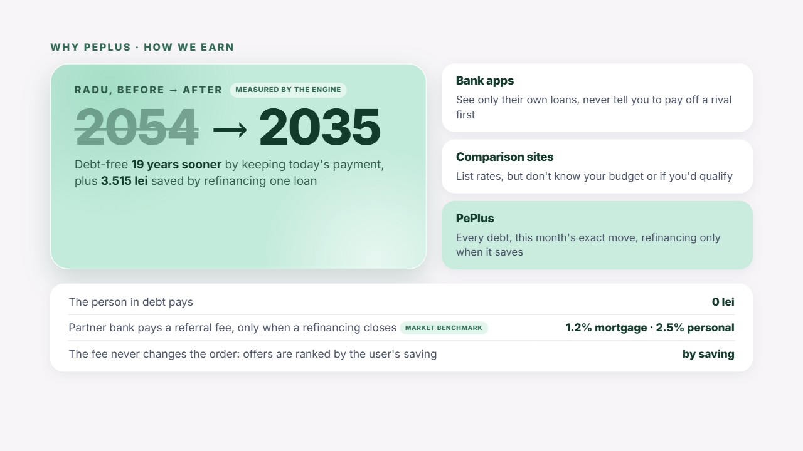

**Model: free for the user, a success fee from the bank.** PePlus works as a registered credit intermediary. When a user refinances through PePlus and the loan is paid out, the partner bank pays a referral fee. The user never pays anything.

<p align="center">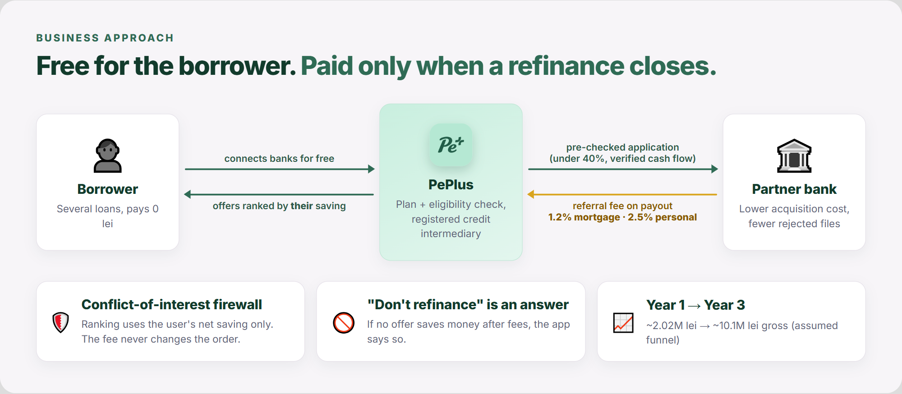</p>

**The conflict-of-interest firewall:** offers are ranked strictly by the user's net saving in lei, never by our commission. If no offer saves money after fees, the app tells the user not to refinance. Trust is the product.

**Why banks would pay:** Romanian banks spend 4,000-6,500 lei to acquire one mortgage customer and waste underwriting time on applicants who fail the 40% limit. PePlus sends applicants whose cash flow and eligibility are already checked, and is paid only on success.

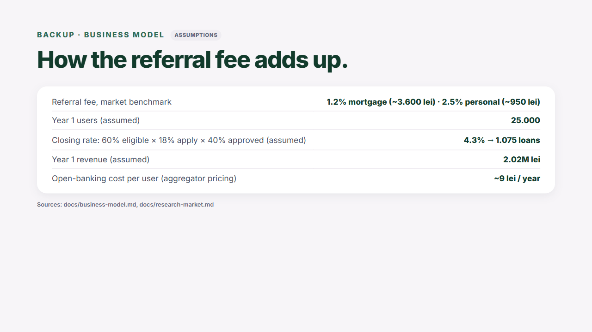

| | Year 1 | Year 3 | Basis |
|---|---|---|---|
| Referral fee per closed loan | ~3,600 lei mortgage · ~950 lei personal | same | Market benchmark (1.2% / 2.5%) |
| Active connected users | 25,000 | 120,000 | Assumption (of a ~450,000 serviceable market) |
| Closing rate | 4.3% (60% eligible × 18% apply × 40% approved) | 4.3% | Assumption |
| Loans closed | 1,075 | 5,400 | |
| **Gross revenue** | **~2.02M lei (~€404k)** | **~10.1M lei (~€2.03M)** | |
| Open-banking cost | ~9 lei per user per year | | Aggregator pricing |

Fees and costs are measured market figures; users and conversion are our assumptions, and the first pilot would measure the real funnel from the "Refinance with &lt;bank&gt;" tap to the bank paying out.

**Next steps, from demo to pilot:**
1. Register with **ANPC** as a credit intermediary (with the required professional indemnity insurance).
2. Connect real banks through a **licensed PSD2 partner** (Finqware or Salt Edge) in a closed beta.
3. **Pilot with two partner banks**, and add alerts when IRCC changes or a new offer beats the user's saving threshold.

---

## How we built it: the tasks

The team worked from a shared task board and a written decision log kept in Git: every task had an owner, a scope of files and a "done" check, and every product choice was recorded with its reason. The work ran in six phases:

<p align="center">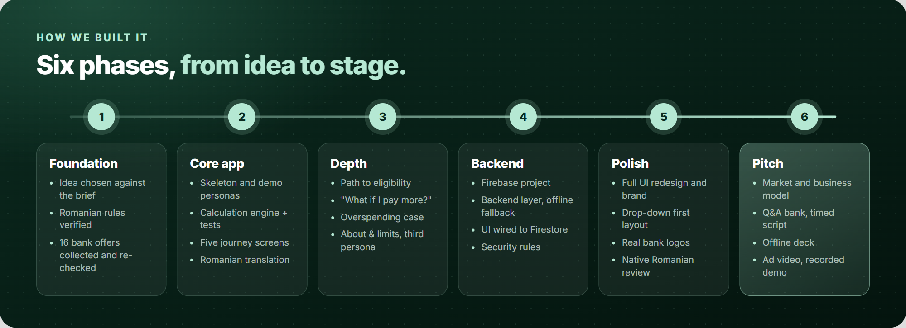</p>

| Phase | Tasks |
|---|---|
| **1. Foundation** | Chose the idea against the judging criteria · verified every Romanian rule with sources (BNR limit, OUG 52/2016, OUG 50/2010, PSD2, Biroul de Credit) · collected 16 refinancing offers from 7 banks and later re-checked each one against its source. |
| **2. Core app** | Expo skeleton with tabs · realistic demo personas · the calculation engine with unit tests · the five screens of the journey · full Romanian translation · an end-to-end pass on the demo path. |
| **3. Depth** | "Not eligible yet, here's your path" · the "What if I pay more?" slider · the overspending case · the About & limitations screen · a third persona so all 7 debt types are covered · `npm run demo-numbers`. |
| **4. Backend** | Firebase project · a backend layer (auth, profile, snapshot, offers, applications) that falls back to local data offline · the UI wired to it · Firestore security rules. |
| **5. Polish** | Visual polish and a full UI redesign · the PePlus name, logo and palette · progressive disclosure · real bank logos · a final review of Home, This month and Goal · a native Romanian language review. |
| **6. Pitch** | Market and competitor research · business model numbers · judge Q&A bank · stage script timed to the second · slide deck with offline video slides · an automated ad video (screen capture, 3D render, generated voice) · an automated demo smoke test and a silent backup recording of the demo. |

---

## Key product decisions

| Decision | Why |
|---|---|
| **The app decides the payoff order** (avalanche by real cost), no snowball vs. avalanche quiz | People with 4-5 loans want one clear instruction, not a textbook choice. |
| **All debt types count**: mortgage, personal, card, overdraft, IFN, BNPL, leasing | Real multi-loan lives include the small expensive ones. |
| **Rank offers only by net saving** after every fee | The business model must never bend the advice. |
| **No credit score**, one honest late-payment question | Biroul de Credit has no public API; the 40% limit is the main legal gate and can be computed from cash flow. |
| **No generative AI in the app** | The money logic must be exact and auditable. |
| **No Plaid** | It doesn't cover Romanian banks or loans; a Romanian PSD2 aggregator does. |
| **Honest "years sooner"** | The minimums-only baseline settles term loans at maturity (Jun 2054), and the Goal screen states the trade-off: Radu keeps paying about 5,100 lei a month until 2035. Most of the gain comes from rolling finished payments forward; the 600 lei extra adds about 21 months. |
| **Drop-down first** | Each screen answers one question; detail is one tap away. |

---

## Real vs. mocked

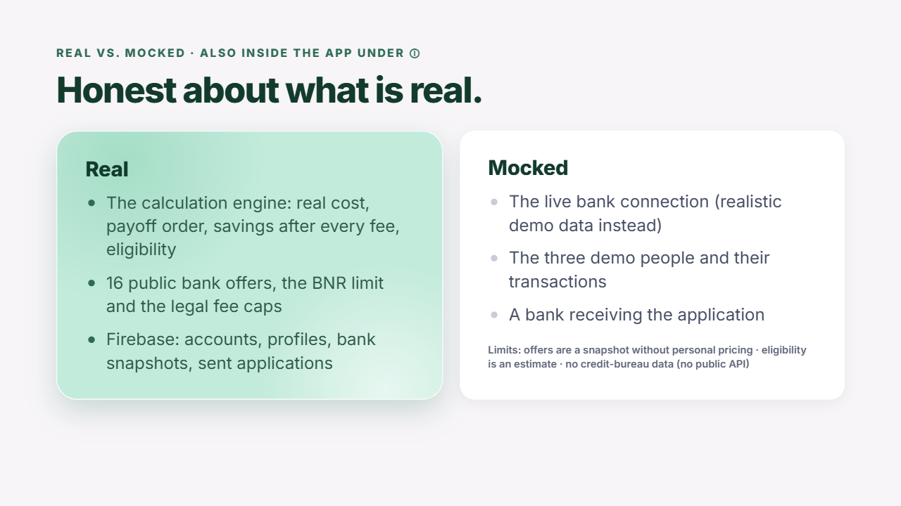

| ✅ Real | 🧪 Mocked |
|---|---|
| The calculation engine: real cost, payoff order, savings after every fee, eligibility | The live bank connection (realistic demo data instead) |
| 16 public bank offers, the BNR limit and the legal fee caps | The three demo people and their transactions |
| Firebase: accounts, profiles, bank snapshots, sent applications | A bank actually receiving the application |

**Limits:** offers are a public snapshot (November 2026) without personal pricing · eligibility is an estimate · no credit-bureau data. All of this is also stated inside the app under **ⓘ**.

---

## Run it

**Prerequisites:** Node.js 24 LTS, npm 10+, and either an Android emulator (API 34+) or a phone with **Expo Go**.

```sh
npm ci
npx expo start          # press a for Android, w for web, or scan the QR with Expo Go
npx expo start --tunnel # if the phone is on a different network
```

The app starts in Romanian; switch to English from the profile sheet (avatar, top left).

```sh
npm test               # 22 engine + backend tests
npm run typecheck      # strict TypeScript check
npm run demo-numbers   # every number used on stage, printed by the engine
npx expo export --platform web   # production web bundle
```

Optional: `npm run seed` uploads the bank offers to your own Firebase project (needs a service-account file, which is git-ignored). Without Firebase the app runs fully on bundled data.

---

## Repository map

<p align="center">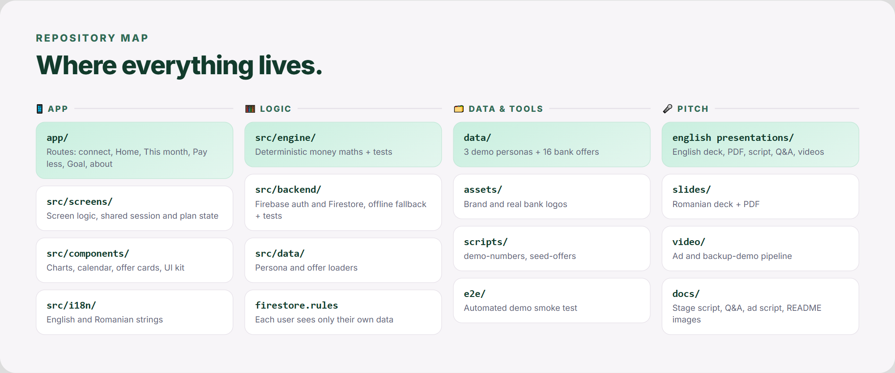</p>

<details>
<summary><b>Full tree</b></summary>

```
PePlus/
├── app/                     # Expo Router routes: connect, overview (Home), plan (This month),
│                            #   refinance (Pay less), progress (Goal), about
├── src/
│   ├── engine/              # Deterministic money maths + tests
│   ├── backend/             # Firebase auth & Firestore, offline fallback + tests
│   ├── screens/             # Screen logic and shared session/plan state
│   ├── components/          # Charts, payment calendar, offer cards, eligibility path, UI kit
│   ├── data/                # Persona & offer loaders, persona context
│   ├── i18n/                # English and Romanian strings, formatting
│   └── theme.ts             # Palette, spacing, typography
├── data/                    # 3 demo personas + 16 bank offers (JSON)
├── assets/                  # Brand logos, real bank logos
├── scripts/                 # demo-numbers, seed-offers
├── e2e/                     # Automated demo smoke test + backup screenshots
├── video/                   # Ad and backup-demo pipeline (Remotion, screen capture, voice)
├── slides/                  # Romanian pitch deck (HTML, offline) + PDF
├── english presentations/   # English pitch kit (deck, PDF, script, Q&A, videos)
├── docs/                    # Stage script, Q&A, ad script, README images
├── firestore.rules          # Per-user data isolation
└── firebase.json
```

</details>

### File guide

What every file does, grouped by layer. Click a group to open it.

<details open>
<summary><b>📱 Routes</b> · <code>app/</code> (Expo Router: one file per screen)</summary>

| File | What it does |
|---|---|
| [`_layout.tsx`](app/_layout.tsx) | Root layout: providers, the four tabs (Home, This month, Pay less, Goal), tab icons, header with the profile avatar. Each tab answers one question. |
| [`index.tsx`](app/index.tsx) | Splash with the brand, then sends the user to Connect or Home once the backend (or offline fallback) has loaded. |
| [`connect.tsx`](app/connect.tsx) | Route for the bank-connection flow. |
| [`overview.tsx`](app/overview.tsx) | **Home** tab: "How bad is it?" |
| [`plan.tsx`](app/plan.tsx) | **This month** tab: "What do I do this month?" |
| [`refinance.tsx`](app/refinance.tsx) | **Pay less** tab: "Can I pay less?" |
| [`progress.tsx`](app/progress.tsx) | **Goal** tab: "When am I free?" |
| [`about.tsx`](app/about.tsx) | About ⓘ: sources, rules, business model, limits. |

Route files stay thin; each one renders its screen from `src/screens/`.
</details>

<details open>
<summary><b>🖥️ Screens</b> · <code>src/screens/</code></summary>

| File | What it does |
|---|---|
| [`ConnectScreen.tsx`](src/screens/ConnectScreen.tsx) | Bank picker, open-banking consent, sync animation; writes the bank snapshot (Firebase, or local when offline). |
| [`OverviewScreen.tsx`](src/screens/OverviewScreen.tsx) | Home: total owed, monthly interest and fees, freedom ring, debt-to-income vs. 40%, a card per debt. |
| [`PlanScreen.tsx`](src/screens/PlanScreen.tsx) | This month: what to pay where, the reason per debt, the "What if I pay more?" slider, payment calendar, overspending help. |
| [`RefinanceScreen.tsx`](src/screens/RefinanceScreen.tsx) | Pay less: offers per debt ranked by net saving, the application sheet, or the path to eligibility. |
| [`ProgressScreen.tsx`](src/screens/ProgressScreen.tsx) | Goal: debt-free date, plan vs. minimums chart, monthly payments chart, milestones. |
| [`AboutScreen.tsx`](src/screens/AboutScreen.tsx) | Data sources, Romanian rules, how PePlus earns, what is simulated. |
| [`PlanContext.tsx`](src/screens/PlanContext.tsx) | Shared plan state: start month, the extra amount, and what is paid in each projected month. |
| [`SessionContext.tsx`](src/screens/SessionContext.tsx) | Session state from the backend: profile, snapshot, applications; blocks duplicate applications. |
| [`dates.ts`](src/screens/dates.ts) | Age from the saved date of birth. |
</details>

<details open>
<summary><b>🧮 Engine</b> · <code>src/engine/</code> (all the money maths)</summary>

| File | What it does |
|---|---|
| [`index.ts`](src/engine/index.ts) | Real yearly cost, budget and surplus, debt-to-income, payoff order, month-by-month simulation, legal exit fees, eligibility, path to eligibility, offer ranking, spending breakdown. |
| [`constants.ts`](src/engine/constants.ts) | The rules as numbers: the BNR 40% limit, early-repayment caps, projection limits, each with its legal source. |
| [`engine.test.mjs`](src/engine/engine.test.mjs) | 18 tests: formulas, legal caps, ranking, eligibility and the exact numbers used on stage. |
</details>

<details>
<summary><b>☁️ Backend</b> · <code>src/backend/</code> (Firebase with offline fallback)</summary>

| File | What it does |
|---|---|
| [`index.ts`](src/backend/index.ts) | Public entry: picks the Firebase backend, falls back to local data when it is unreachable. |
| [`service.ts`](src/backend/service.ts) | Backend contract: profile (city, date of birth, late-payment answer), bank snapshot, offers, applications. |
| [`firebase.ts`](src/backend/firebase.ts) | Firestore implementation of that contract, with timeouts. |
| [`auth.ts`](src/backend/auth.ts), [`auth.native.ts`](src/backend/auth.native.ts) | Anonymous sign-in, with persistent sessions on web and on the phone. |
| [`firebaseConfig.ts`](src/backend/firebaseConfig.ts) | Public Firebase web config (access is controlled by `firestore.rules`). |
| [`backend.test.mjs`](src/backend/backend.test.mjs) | 4 tests for the backend layer and its fallback. |
</details>

<details>
<summary><b>🧩 Components</b> · <code>src/components/</code></summary>

| File | What it does |
|---|---|
| [`refinance/OfferCard.tsx`](src/components/refinance/OfferCard.tsx) | One bank offer: new rate, monthly payment, net saving, "Refinance with &lt;bank&gt;". |
| [`refinance/ApplicationSheet.tsx`](src/components/refinance/ApplicationSheet.tsx) | Simulated application ending in "Application sent" with a reference number. |
| [`refinance/EligibilityPath.tsx`](src/components/refinance/EligibilityPath.tsx) | "Not eligible yet, here's your path": why, what to pay off, by when. |
| [`LineChart.tsx`](src/components/LineChart.tsx) | Balance over time: the plan vs. paying only minimums. |
| [`PaymentCalendar.tsx`](src/components/PaymentCalendar.tsx) | The month's due days for each debt. |
| [`BankLogo.tsx`](src/components/BankLogo.tsx) | Real lender logos on a uniform tile. |
| [`PersonaSwitcher.tsx`](src/components/PersonaSwitcher.tsx) | Profile avatar and sheet: switch demo profile and language. |
| [`SessionBits.tsx`](src/components/SessionBits.tsx) | Offline note and the late-payment question. |
| [`TabIcons.tsx`](src/components/TabIcons.tsx) | Tab icons drawn with plain views (no icon font). |
| [`ui/index.tsx`](src/components/ui/index.tsx) | UI kit: screen, card, hero card. |
| [`ui/Collapsible.tsx`](src/components/ui/Collapsible.tsx) | "Drop-down first" row that keeps its key value visible when closed. |
| [`ui/FreedomRing.tsx`](src/components/ui/FreedomRing.tsx), [`ui/ProgressArc.tsx`](src/components/ui/ProgressArc.tsx) | Progress-to-debt-free ring and arc. |
| [`ui/GlassHero.tsx`](src/components/ui/GlassHero.tsx) | Frosted mint card with a slowly drifting light. |
| [`ui/Slider.tsx`](src/components/ui/Slider.tsx) | Accessible drag slider, no extra library. |
| [`ui/useTween.ts`](src/components/ui/useTween.ts) | Animates numbers smoothly to their new value. |
</details>

<details>
<summary><b>🗂️ Data, language and shared types</b></summary>

| File | What it does |
|---|---|
| [`data/persona-1.json`](data/persona-1.json) · [`-2`](data/persona-2.json) · [`-3`](data/persona-3.json) | Demo profiles Radu, Elena and Andrei: accounts, debts and 90 days of transactions. |
| [`data/bank-offers.json`](data/bank-offers.json) | 16 refinancing offers from 7 banks, with source links (Nov 2026). |
| [`src/data/index.ts`](src/data/index.ts) | Loads personas and offers. |
| [`src/data/PersonaContext.tsx`](src/data/PersonaContext.tsx) | Keeps the chosen demo profile the same on every tab. |
| [`src/i18n/en.ts`](src/i18n/en.ts), [`ro.ts`](src/i18n/ro.ts) | Every English and Romanian string. |
| [`src/i18n/index.tsx`](src/i18n/index.tsx) | Language provider and the `t()` hook, Romanian number formatting. |
| [`src/i18n/format.ts`](src/i18n/format.ts) | Dates, durations and debt names in both languages. |
| [`src/types.ts`](src/types.ts) | Shared data contract (all money in lei, rates as annual %). |
| [`src/theme.ts`](src/theme.ts) | Palette, spacing, typography. |
| [`assets/`](assets/) | Brand logos and real bank logos. |
</details>

<details>
<summary><b>🛠️ Scripts, tests and config</b></summary>

| File | What it does |
|---|---|
| [`scripts/demo-numbers.mjs`](scripts/demo-numbers.mjs) | Prints every number used on stage, straight from the engine. |
| [`scripts/seed-offers.mjs`](scripts/seed-offers.mjs) | Uploads the bank offers to Firestore (needs a service-account file, which is git-ignored). |
| [`e2e/run-e2e.mjs`](e2e/run-e2e.mjs) | Automated demo smoke test on the web build at phone size; screenshots go in `e2e/backup/`. |
| [`firestore.rules`](firestore.rules) | Each user reads and writes only their own data; offers are read-only. |
| [`firebase.json`](firebase.json), [`app.json`](app.json), [`tsconfig.json`](tsconfig.json), [`package.json`](package.json) | Firebase, Expo, TypeScript and npm config. |
</details>

<details>
<summary><b>🎬 Video pipeline</b> · <code>video/</code> (ad and recorded demo)</summary>

| File | What it does |
|---|---|
| [`src/Ad.tsx`](video/src/Ad.tsx) | The ad composition (16:9 and 9:16), timed to the voice lines. |
| [`src/Backup.tsx`](video/src/Backup.tsx) | Recorded demo framed for a projector, with phase captions and a stage clock. |
| [`src/kit.tsx`](video/src/kit.tsx) | Shared look and motion helpers. |
| [`src/Root.tsx`](video/src/Root.tsx), [`src/index.ts`](video/src/index.ts) | Registers the compositions. |
| [`src/timeline.json`](video/src/timeline.json), [`src/words.json`](video/src/words.json) | Voice timing and word timings for captions (generated). |
| [`capture/capture.mjs`](video/capture/capture.mjs) | Captures app screens for the ad. |
| [`backup/record.mjs`](video/backup/record.mjs) | Records the stage demo from the real web build. |
| [`backup/elena-shots.mjs`](video/backup/elena-shots.mjs), [`backup/qa-shots.mjs`](video/backup/qa-shots.mjs) | Screenshots for the deck and for visual checks. |
| [`scripts/voice.mjs`](video/scripts/voice.mjs) | Builds the voice-over, sound effects and timeline. |
| [`scripts/tts_gemini.py`](video/scripts/tts_gemini.py), [`scripts/split_vo.py`](video/scripts/split_vo.py) | Generates the narration and splits it into lines. |
| [`scripts/words.py`](video/scripts/words.py) | Word timestamps for captions. |
| [`scripts/render.mjs`](video/scripts/render.mjs) | Renders the final MP4s with a peak limiter. |
| [`scripts/stills.mjs`](video/scripts/stills.mjs), [`scripts/deck-shots.mjs`](video/scripts/deck-shots.mjs), [`scripts/deck-keys-test.mjs`](video/scripts/deck-keys-test.mjs) | Checks: sample frames, deck screenshots and PDF, deck keyboard test. |
| `public/`, `vo-src/`, `out/` | Media inputs (screens, logos, sounds, voice) and rendered videos. |
</details>

<details>
<summary><b>🎤 Pitch and docs</b></summary>

| File | What it does |
|---|---|
| [`slides/index.html`](slides/index.html), [`slides/peplus.pdf`](slides/peplus.pdf) | Romanian deck (offline) and its PDF. |
| [`english presentations/`](english%20presentations/) | English deck, PDF, stage script, Q&A, ad script, videos, voice takes; its own [README](english%20presentations/README.md) explains rebuilding. |
| [`docs/presentation-script.md`](docs/presentation-script.md) | Stage script, second by second. |
| [`docs/qa.md`](docs/qa.md) | Judge Q&A bank. |
| [`docs/ad/script.md`](docs/ad/script.md) | Ad script and storyboard. |
| [`docs/readme/`](docs/readme/) | Images in this README; `source/` holds the diagram page and its render script. |
</details>

---

## Pitch kit

| | English | Romanian |
|---|---|---|
| Slide deck (offline HTML; **B** backup demo, **1-5** demo phases, **A** ad, **F** fullscreen) | [`english presentations/deck/index.html`](english%20presentations/deck/index.html) | [`slides/index.html`](slides/index.html) |
| PDF of the deck | [`english presentations/peplus.pdf`](english%20presentations/peplus.pdf) | [`slides/peplus.pdf`](slides/peplus.pdf) |
| Stage script, second by second (4 min + Q&A) | [`english presentations/presentation-script.md`](english%20presentations/presentation-script.md) | [`docs/presentation-script.md`](docs/presentation-script.md) |
| Judge Q&A bank | [`english presentations/qa.md`](english%20presentations/qa.md) | [`docs/qa.md`](docs/qa.md) |
| Ad (21 s, 16:9 and 9:16) | [`english presentations/videos/`](english%20presentations/videos/) | [`video/out/`](video/out/) |
| Silent recorded demo, timed to the script | [`english presentations/videos/demo-backup.mp4`](english%20presentations/videos/demo-backup.mp4) | [`video/out/demo-backup.mp4`](video/out/demo-backup.mp4) |

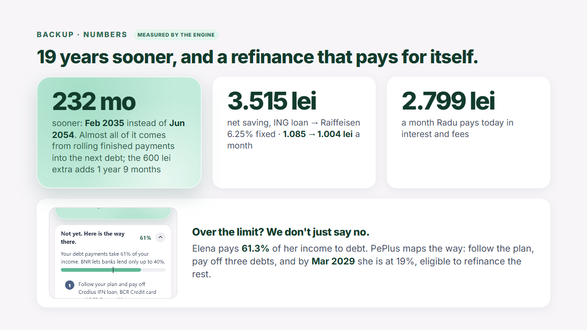

---

## Team

| | Role on stage |
|---|---|
| **sucheasilviu** | Main presenter |
| **Ancusii** | Product & UX, demo operator |
| **cretualex** | Business & regulation |
| **mihaiditu** | Technical & architecture |

<div align="center">
<br/>
<br/>
<sub>Made in Romania for Stripe VibeHack Constanța 2026.</sub>
</div>
